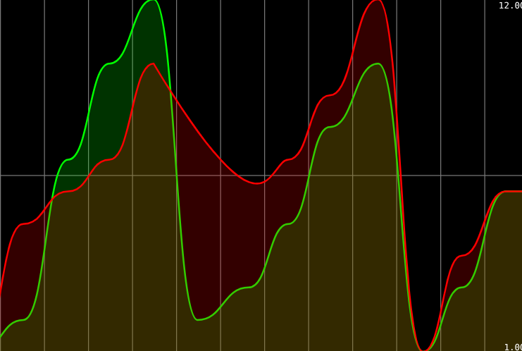
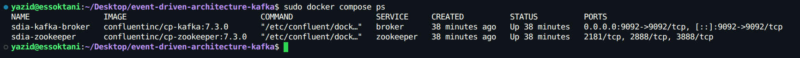

<div align="center">
  <!-- En-tête créatif animé -->
  

  <!-- Animation texte descriptive -->
  

  <br/>

  <!-- Badges technologiques -->
  <p>
    
    
    
    
    
    
  </p>
</div>

---

## À propos du projet

**Event-Driven Architecture Kafka** est une solution complète de traitement et de visualisation d'événements en streaming conçue avec **Spring Cloud Stream** et **Apache Kafka**.

Elle permet aux ingénieurs et développeurs de construire une chaîne de traitement événementielle réactive, intégrant :
- L'ingestion asynchrone de messages via REST (`StreamBridge`) et génération périodique continue (`Supplier` cadencé à 200 ms).
- Le traitement de flux en temps réel avec **Kafka Streams** (filtrage, partitionnement, fenêtrage de 5 secondes et agrégation).
- La matérialisation de l'état dans un store local interrogeable (`count-store` via `InteractiveQueryService`).
- La diffusion réactive vers le client via **Server-Sent Events (SSE)** et le rendu graphique animé avec **Smoothie.js**.

> [!NOTE]
> Pour une analyse approfondie des choix techniques et des schémas d'architecture détaillés, consultez le document [Architecture du Système](docs/ARCHITECTURE.md) et la [Référence des API](docs/API.md).

---

## Fonctionnalités Clés

- **Architecture Découplée & Asynchrone :** Communication sans adhérence directe entre producteurs et consommateurs grâce aux topics Kafka.
- **Moteur Kafka Streams Intégré :** Traitement analytique en temps réel calculant la fréquence de consultation de pages sur fenêtres temporelles glissantes sans blocage.
- **Stockage d'État Local Haute Performance :** Utilisation d'un state store RocksDB/In-Memory interrogeable dynamiquement à la demande.
- **Diffusion Réactive SSE :** Transmission en streaming continu des données calculées sans rechargement ni polling agressif.
- **Dashboard Dynamique Ultra-Fluide :** Visualisation par courbes de navigation interactives grâce à la bibliothèque Smoothie Charts.

---

## Stack Technique

| Couche | Technologies |
| :--- | :--- |
| **Backend & Ingestion** | Java 17/21, Spring Boot 4.1.1, Spring Cloud Stream 2025.1.3 |
| **Streaming & Message Broker** | Apache Kafka 7.3.0, Confluent Platform, Kafka Streams Binder |
| **Frontend & Visualisation** | HTML5, JavaScript moderne, Smoothie.js (Canvas temps réel) |
| **Infrastructure & DevOps** | Docker, Docker Compose, Apache Zookeeper, Maven Wrapper |

---

## Aperçu Visuel & Galerie

Le bon fonctionnement de chaque étape du pipeline (infrastructure conteneurisée, ingestion REST, streaming continu, traitement fenêtré Kafka Streams et restitution graphique) est illustré par des captures d'écran réelles :

<div align="center">
  <table width="100%">
    <tr>
      <td width="50%" align="center">
        <b>Tableau de Bord Smoothie.js (Temps Réel)</b><br/><br/>
        
      </td>
      <td width="50%" align="center">
        <b>Cluster Kafka & Zookeeper (Docker)</b><br/><br/>
        
      </td>
    </tr>
  </table>

  <br/>
  
  <p>
    👉 <b><a href="docs/SCREENSHOTS.md">Consulter la galerie complète des 8 captures d'écran d'exécution &rarr;</a></b>
  </p>
</div>

---

## Pour commencer

### Prérequis

- **Docker & Docker Compose** (version 24.0 ou supérieure)
- **Java JDK 17 ou 21**
- **Maven** (ou utilisation directe du wrapper `./mvnw`)

### Installation & Lancement

1. **Cloner le projet :**
   ```bash
   git clone https://github.com/essoktani-yazid/event-driven-architecture-kafka.git
   cd event-driven-architecture-kafka
   ```

2. **Démarrer les conteneurs Kafka & Zookeeper :**
   ```bash
   docker compose up -d
   ```

3. **Compiler et exécuter l'application Spring Boot :**
   ```bash
   ./mvnw clean spring-boot:run
   ```

4. **Accéder aux interfaces et services :**
   - API de publication : `http://localhost:8080/publish?name=P1&topic=T2`
   - Flux analytique SSE : `http://localhost:8080/analytics`
   - Dashboard Smoothie.js : `http://localhost:8080/index.html`

---

## Structure du Projet

```text
.
├── compose.yml                                       # Orchestration Docker (Kafka Broker & Zookeeper)
├── pom.xml                                           # Dépendances Maven (Spring Boot, Cloud Stream, KStreams)
├── docs/
│   ├── ARCHITECTURE.md                               # Schémas et description détaillée de l'architecture
│   ├── API.md                                        # Spécification exhaustive des endpoints et contrats
│   ├── SCREENSHOTS.md                                # Galerie complète des 8 captures d'écran
│   └── assets/
│       └── screenshots/                              # Fichiers images des captures d'écran
├── src/
│   ├── main/
│   │   ├── java/net/essoktani/kafkaspringcloudstream/
│   │   │   ├── KafkaSpringCloudStreamApplication.java # Point d'entrée Spring Boot
│   │   │   ├── controllers/
│   │   │   │   └── PageEventController.java          # Endpoints REST /publish et réactif SSE /analytics
│   │   │   ├── events/
│   │   │   │   └── PageEvent.java                    # Modèle de données immuable (Record)
│   │   │   └── handlers/
│   │   │       └── PageEventHandler.java            # Consumer, Supplier et fonction de traitement KStream
│   │   └── resources/
│   │       ├── application.properties                # Configuration des bindings et du binder Kafka Streams
│   │       └── static/
│   │           └── index.html                        # Dashboard Smoothie.js temps réel
│   └── test/
│       └── java/net/essoktani/kafkaspringcloudstream/
│           └── KafkaSpringCloudStreamApplicationTests.java
├── LICENSE                                           # Licence MIT officielle
└── README.md                                         # Documentation principale du projet
```

---

## Auteur

<div align="center">

**Yazid ESSOKTANI**  
*Full-Stack Web & AI Developer*

[](https://www.essoktani.tech/)
[](https://www.linkedin.com/in/yazid-essoktani-337549251)
[](https://github.com/essoktani-yazid)

</div>

---

## Licence

Distribué sous la licence **MIT**. Consultez le fichier [`LICENSE`](LICENSE) pour plus d'informations.
