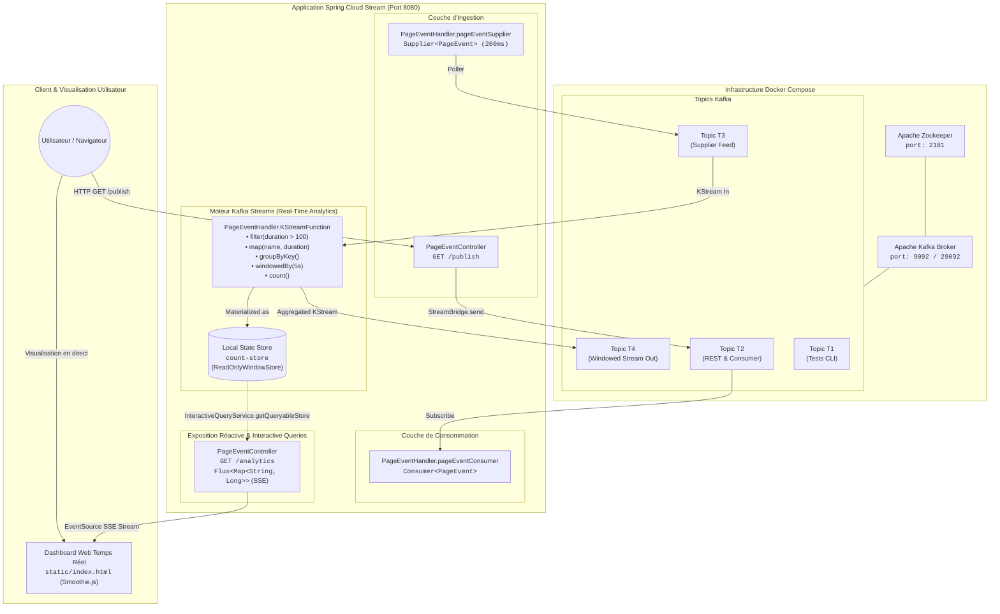
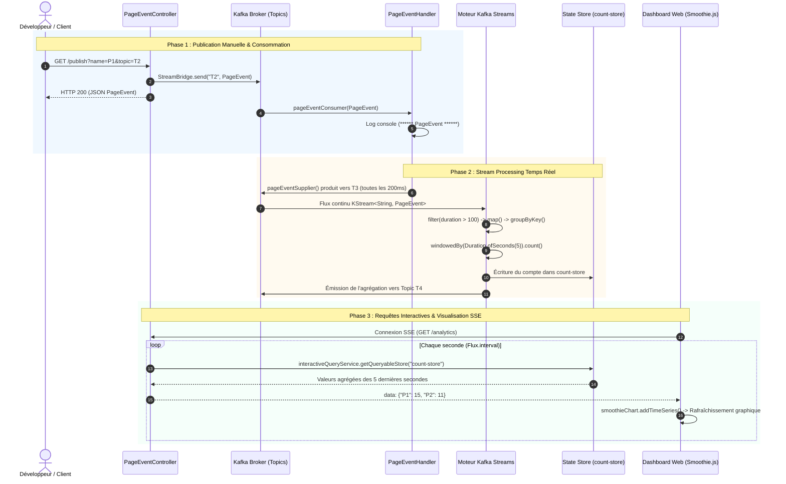

# Architecture du Système — Event-Driven Architecture avec Apache Kafka & Spring Cloud Stream

> Ce document détaille l'architecture logicielle, les flux asynchrones, le moteur de traitement en temps réel Kafka Streams et les choix de conception du projet **Event-Driven Architecture Kafka**.

---

## 1. Vue d'ensemble (High-Level Design)

Le projet implémente une **Architecture Événementielle (EDA - Event-Driven Architecture)** hautement scalable et découplée, articulée autour de **Spring Cloud Stream** et **Apache Kafka**.

Elle combine plusieurs paradigmes majeurs du génie logiciel moderne :
1. **Production & Ingestion d'événements :** Publication manuelle (via contrôleur REST et `StreamBridge`) et génération automatisée par échantillonnage continu (`Supplier` cadencé à 200 ms).
2. **Consommation Réactive :** Souscription asynchrone aux messages via des bindings fonctionnels Spring Cloud Stream (`Consumer<PageEvent>`).
3. **Traitement de Flux en Temps Réel (Stream Processing) :** Moteur **Kafka Streams** agrégeant les événements de visites par page sur des fenêtres temporelles glissantes de 5 secondes (`TimeWindows.ofSizeWithNoGrace`).
4. **Requêtes Interactives & Persistance en Mémoire :** Stockage d'état local via un state store RocksDB/In-Memory (`count-store`) interrogé dynamiquement par `InteractiveQueryService`.
5. **Diffusion Réactive & Visualisation Live :** Exposition des résultats sous forme de flux **Server-Sent Events (SSE)** vers une interface web dynamique construite avec **Smoothie.js**.



---

## 2. Composants Principaux

| Composant | Package / Fichier | Rôle & Responsabilités |
| :--- | :--- | :--- |
| **Apache Zookeeper** | `compose.yml` (`confluentinc/cp-zookeeper:7.3.0`) | Coordination du cluster Kafka, synchronisation des métadonnées et élection de leader. |
| **Kafka Broker** | `compose.yml` (`confluentinc/cp-kafka:7.3.0`) | Courtier de messages distribué gérant les partitions, la réplication et la persistance des topics (`T1`, `T2`, `T3`, `T4`). |
| **Modèle de Domaine** | `net.essoktani.kafkaspringcloudstream.events.PageEvent` | Record Java 17/21 immuable représentant un événement de navigation (`name`, `user`, `date`, `duration`). |
| **REST Event Producer** | `net.essoktani.kafkaspringcloudstream.controllers.PageEventController` | Expose l'endpoint `GET /publish` pour injecter des événements à la demande via `StreamBridge`. |
| **Event Consumer** | `net.essoktani.kafkaspringcloudstream.handlers.PageEventHandler#pageEventConsumer` | Bean `Consumer<PageEvent>` enregistrant et loguant les événements reçus du topic `T2`. |
| **Event Supplier** | `net.essoktani.kafkaspringcloudstream.handlers.PageEventHandler#pageEventSupplier` | Bean `Supplier<PageEvent>` générant automatiquement des visites aléatoires (`P1`, `P2`, `U1`, `U2`) toutes les 200 ms vers `T3`. |
| **Kafka Streams Processor** | `net.essoktani.kafkaspringcloudstream.handlers.PageEventHandler#KStreamFunction` | Pipeline fonctionnel calculant le volume de visites par page sur des fenêtres de 5 secondes avec state store matérialisé `count-store`. |
| **Interactive Query Service** | `net.essoktani.kafkaspringcloudstream.controllers.PageEventController#analytics` | Interroge le store local fenêtré `count-store` et pousse un flux continu SSE (`text/event-stream`) chaque seconde. |
| **Dashboard Web UI** | `src/main/resources/static/index.html` | Page HTML5 légère exploitant **Smoothie.js** pour tracer les courbes de trafic en streaming temps réel. |

---

## 3. Flux de Données & Cycle de Vie des Événements

Le diagramme de séquence ci-dessous illustre l'orchestration complète entre l'ingestion, le stream processing et la restitution graphique :



---

## 4. Modèle de Données & Stockage Local

### Structure du Record `PageEvent`
```java
package net.essoktani.kafkaspringcloudstream.events;

import java.util.Date;

public record PageEvent(
    String name,     // Identifiant de la page (ex: P1, P2)
    String user,     // Identifiant de l'utilisateur (ex: U1, U2)
    Date date,       // Timestamp d'occurrence de l'événement
    long duration    // Durée de visite en millisecondes (10 à 10000 ms)
) {}
```

### Table Matérialisée `count-store`
- **Type :** `ReadOnlyWindowStore<String, Long>`
- **Fenêtrage :** 5 secondes (`TimeWindows.ofSizeWithNoGrace(Duration.ofSeconds(5))`)
- **Intervalle de commit :** 1 000 ms (`spring.cloud.stream.kafka.streams.binder.configuration.commit.interval.ms=1000`)
- **Mécanisme d'interrogation :** `store.fetchAll(Instant.now().minusSeconds(5), Instant.now())` avec agrégation continue via `result.merge(kv.key.key(), kv.value, Long::sum)`.

---

## 5. Déploiement & Configuration Réseau

- **Réseau Docker :** Confluent Kafka (`sdia-kafka-broker`) et Zookeeper (`sdia-zookeeper`) communiquent sur un réseau interne dédié avec protocoles `PLAINTEXT` (port local `9092`, port interne `29092`).
- **Application Spring Boot :** Exécutée sur le port `8080`, elle se connecte directement au broker Kafka local `localhost:9092`.

---
[⬅ Retour au README principal](../README.md)
