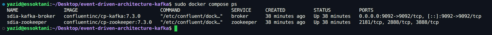
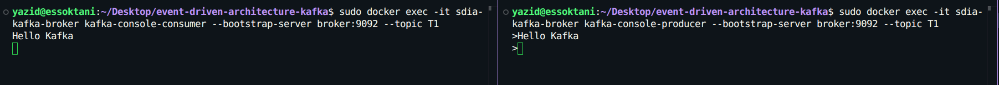
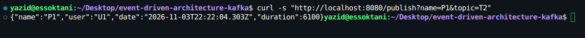
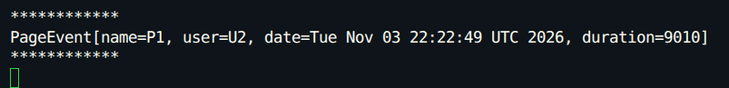
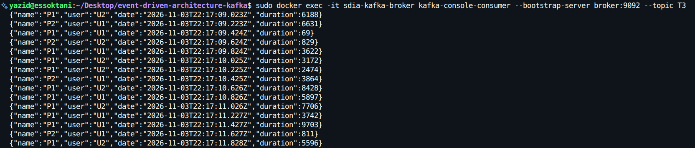
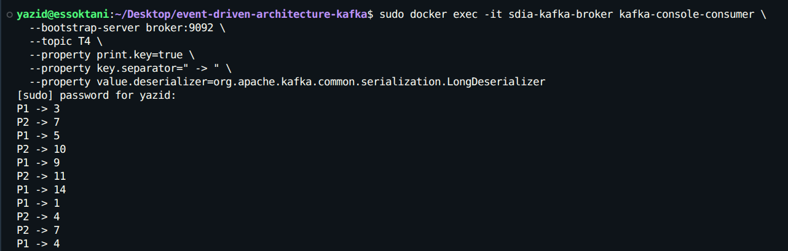
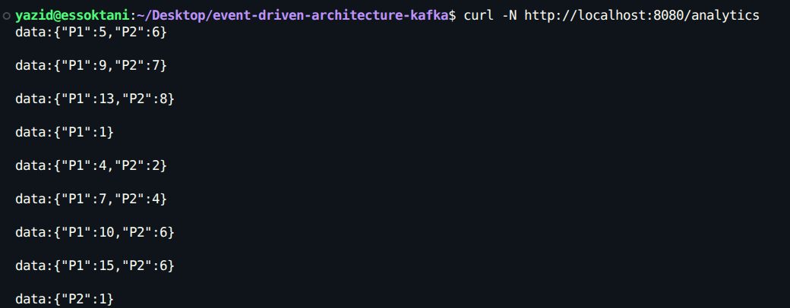
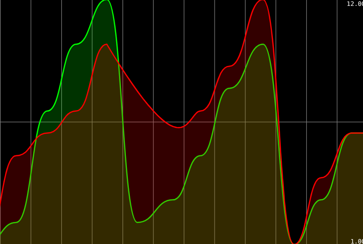

# Galerie Visuelle & Preuves d'Exécution

> Ce document regroupe l'ensemble des captures d'écran validant le bon fonctionnement de chaque composant de l'architecture événementielle (Cluster Kafka, Ingestion REST, Consumer/Supplier réactifs, Kafka Streams et Dashboard Web).

---

## 1. Infrastructure Conteneurisée

### Démarrage du cluster Kafka & Zookeeper via Docker Compose
Vérification de l'état opérationnel (`Up`) des conteneurs `sdia-zookeeper` (port `2181`) et `sdia-kafka-broker` (port `9092`).

  

---

### Test interactif Console Producer & Consumer sur Topic T1
Validation des échanges directs en ligne de commande entre le producteur et le consommateur natifs de Kafka.

  

---

## 2. Ingestion & Consommation Réactive

### Publication d'événements via le Contrôleur REST (`/publish`)
Appel HTTP GET déclenchant l'envoi d'un événement `PageEvent` vers le topic `T2` au moyen de `StreamBridge`.

  

---

### Logs d'interception du consommateur (`pageEventConsumer`)
Réception asynchrone et affichage formaté de l'événement intercepté dans la console de l'application Spring Boot.

  

---

## 3. Streaming Continu & Traitement Fenêtré Kafka Streams

### Production automatisée périodique du Supplier sur le Topic T3
Flux continu d'événements `PageEvent` générés automatiquement toutes les 200 ms par le bean `pageEventSupplier`.

  

---

### Agrégation fenêtrée en temps réel Kafka Streams sur le Topic T4
Résultat du traitement analytique (`KStreamFunction`) partitionné par clé de page (`P1`, `P2`) et comptabilisé sur des fenêtres glissantes de 5 secondes.

  

---

## 4. Exposition Réactive & Interface Utilisateur

### Flux réactif Server-Sent Events (SSE) via `/analytics`
Diffusion en direct (1 paquet par seconde) des comptages récents agrégés depuis le state store local `count-store`.

  

---

### Tableau de bord web interactif en streaming (Smoothie.js)
Visualisation dynamique et fluide des courbes de trafic en temps réel pour chaque page consultée.

  

---

[⬅ Retour au README principal](../README.md)
